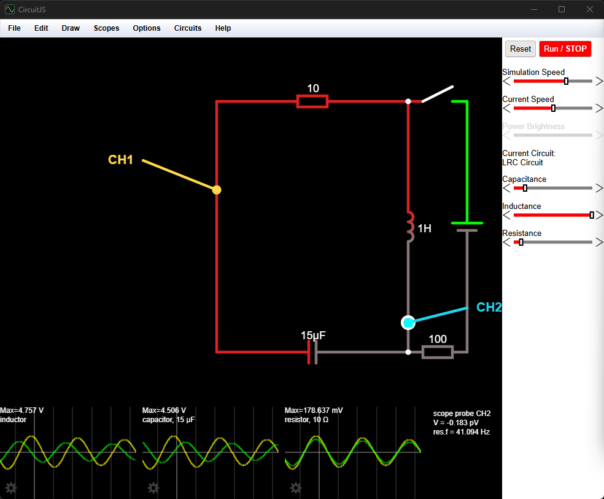
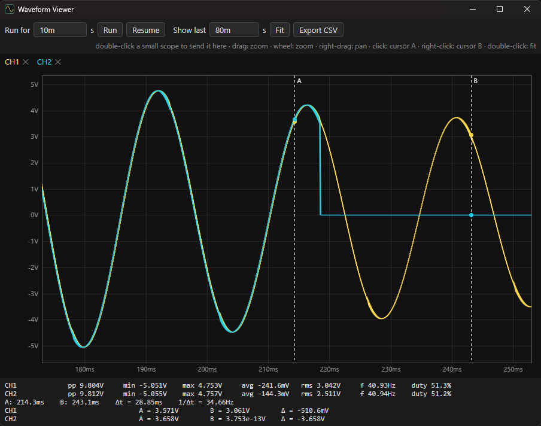
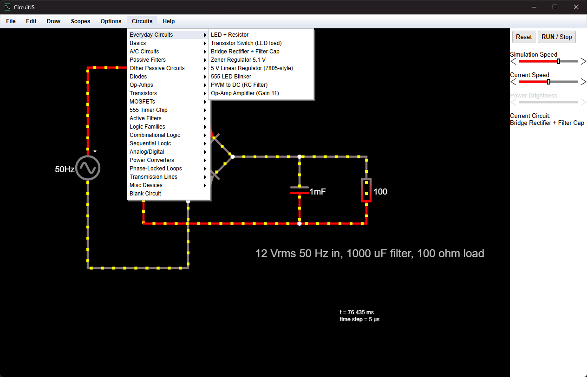
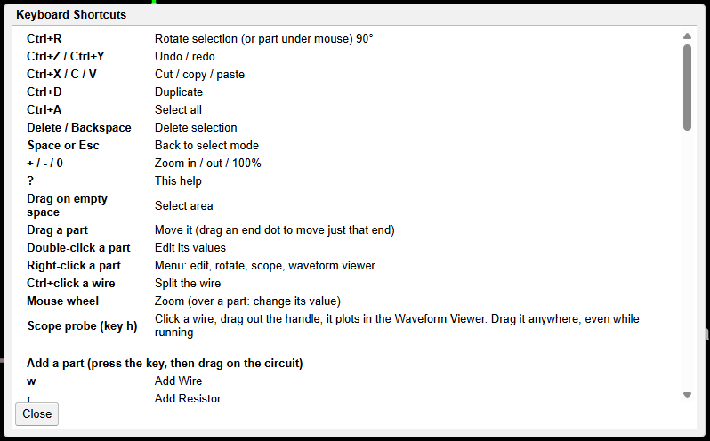

# CircuitJS Desktop

An interactive electronics simulator for Windows. Draw a circuit, watch the current flow, and probe it
like a real bench: drop oscilloscope probes on any wire, freeze the screen, and measure with cursors.

Based on [CircuitJS1](https://github.com/sharpie7/circuitjs1) by Paul Falstad and Iain Sharp, packaged as a
small native app (Rust + Tauri, ~7 MB) with a big waveform viewer and other additions.




## Download

Get the latest release from the [Releases page](https://github.com/sudo-atharva/circuitjs-desktop/releases):

- `CircuitJS_1.1.0_x64-setup.exe`: installer (per user, no admin needed). Registers `.csim` files so they open on double-click.
- `circuitjs.exe`: portable, no install.

Needs Windows 10 or 11 (uses the built-in WebView2). The app is not code-signed yet, so Windows SmartScreen
may warn the first time: click *More info → Run anyway*.

## What it adds to CircuitJS

- **Oscilloscope probes.** Press `h`, click a wire, drag out the handle. Each probe is a channel in the
  Waveform Viewer with a fixed color (CH1 yellow, CH2 cyan, CH3 magenta, CH4 blue...). Drag a probe anywhere,
  even while the circuit runs, and its trace follows. A hollow tip with `?` means it is not touching anything.
- **Waveform Viewer**, a large LTspice-style plot window:
  - live measurements per channel: peak-to-peak, min, max, average, RMS, frequency, duty cycle
  - cursors A/B (click / right-click) with Δt, 1/Δt and the difference of each trace
  - *Pause/Resume*, *Show last* timebase (e.g. `20m` for the last 20 ms, like a scope), zoom and pan
  - *Run for*: transient run from t = 0 that stops at a set time
  - *Export CSV*
  - double-click any small scope to move its traces here, or right-click a part → *Plot Voltage/Current*
- **`.csim` circuit files** with native Open/Save dialogs (old `.txt` circuits still open).
- **Rotate** with Ctrl+R, and a **keyboard cheat sheet** (`?` or Help → Keyboard Shortcuts).
- **Everyday Circuits** menu: LED + resistor, transistor switch, bridge rectifier, zener and 7805-style
  regulators, 555 blinker, PWM filter, op-amp amplifier (also in [examples/](examples/)).
- **Scope frequency readout fixed**: small scopes now show the frequency of slow and compressed signals too.
- **MCP server (optional)** so AI assistants such as Claude Code and Claude Desktop can build and simulate
  circuits (see below). Claude Desktop launches it directly with `circuitjs.exe --mcp-stdio`, no Node.js needed.



## Quick start

1. Open **Circuits → Everyday Circuits → 555 LED Blinker** (or any example).
2. Press `h`, click on a wire and drag a little to place probe CH1. The Waveform Viewer opens.
3. Place a second probe somewhere else, then drag the probes around while it runs.
4. In the viewer press **Pause**, click for cursor A, right-click for cursor B, and read the values below the plot.

Press `?` for all keyboard shortcuts:



## Frequency range

The frequency readouts (scopes, Waveform Viewer, MCP) time the signal's rising edges, so the limits come from the
simulation **time step**, not the screen. Measured with a 1 V sine at the default 5 µs step:

| Signal | Samples per cycle | Frequency reading | Peak reading (true 1 V) |
|---|---|---|---|
| 0.5 Hz to 10 kHz | 20 or more | exact | 1.000 V |
| 20 kHz | 10 | exact | 0.951 V |
| 30 to 60 kHz | 3.3 to 6.7 | exact | 0.95 to 1.00 V |
| 80 kHz | 2.5 | +3 % | 0.951 V |
| 100 kHz and up | 2 or fewer | none shown | wrong (aliasing) |

- **Max:** frequency reads exactly up to about 1 / (3.3 × time step): 60 kHz at 5 µs, 300 kHz at 1 µs (measured).
  For waveforms whose *shape* matters, stay at 20+ samples per cycle (about 10 kHz at 5 µs).
  Set a smaller time step in Options → Other Options for faster circuits; the simulation then runs slower.
- **Min:** no hard limit. The counter needs about 2 full cycles in view: widen the Viewer's *Show last*, slow the
  small scope, or use a longer *Run for* time. Above the limit it shows nothing rather than a wrong number.

## MCP server (AI control)

Off by default. Turn it on in **Options → Enable MCP Server (AI control)**. While on, any program on this PC can
drive the simulator through `http://127.0.0.1:7432/mcp` (not reachable from other machines; change the port with
the `CIRCUITJS_MCP_PORT` environment variable).

**Claude Code**, all projects:

```
claude mcp add --transport http --scope user circuitjs http://127.0.0.1:7432/mcp
```

**Claude Desktop**: Settings → Developer → Edit Config, add the entry below, then quit Claude from the tray and
reopen it. `--mcp-stdio` runs a small bridge to the running app, so no Node.js is needed. Use the path of your
`circuitjs.exe` (the installer puts it in `%LOCALAPPDATA%\CircuitJS` by default), with `\\` in JSON:

```json
{
  "mcpServers": {
    "circuitjs": {
      "command": "C:\\Users\\YOU\\AppData\\Local\\CircuitJS\\circuitjs.exe",
      "args": ["--mcp-stdio"]
    }
  }
}
```

The config file is `%APPDATA%\Claude\claude_desktop_config.json`, or for the Microsoft Store version of Claude
`%LOCALAPPDATA%\Packages\Claude_pzs8sxrjxfjjc\LocalCache\Roaming\Claude\claude_desktop_config.json`
(Edit Config opens the right one).

Claude Desktop connects even while CircuitJS is closed. Tool calls then return "CircuitJS is not running" until
you start the app and turn on the MCP option.

Tools: `list_examples`, `load_example`, `get_circuit`, `load_circuit`, `list_elements`,
`simulate` (transient run with probes; returns min/max/avg/rms/frequency and a resampled waveform),
`set_running`. Simulations requested over MCP run at full CPU speed and pause the circuit at the stop time so the
plots stay frozen; press Run/Stop or ask the AI to resume. Keep the app window open (not minimized): Windows slows
down hidden pages.

## Known limitations

- Probes measure voltage to ground only (no differential or current probe yet).
- Chips (555, logic ICs) and text move when rotated but keep their orientation.
- The Waveform Viewer records from when a trace is added; earlier history from a small scope is not copied.
- Moving a part does not drag its wires along.

## Building from source

Needs JDK 11+, Rust and Node.js.

```
# 1. compile the Java simulator to JavaScript (download the GWT 2.12.2 SDK and unzip it next to the repo)
java -cp "src;gwt-2.12.2/gwt-user.jar;gwt-2.12.2/gwt-dev.jar" com.google.gwt.dev.Compiler -war war -sourceLevel 1.8 com.lushprojects.circuitjs1.circuitjs1
# 2. build the app
cd desktop && npx @tauri-apps/cli@2 build
# -> desktop/target/release/circuitjs.exe                           (portable)
# -> desktop/target/release/bundle/nsis/CircuitJS_*_x64-setup.exe   (installer)
```

GitHub Actions (`.github/workflows/build.yml`) builds both on every push; pushing a tag like `v1.0.0`
attaches them to a GitHub release.

Layout: `src/` is the simulator (Java, compiled by GWT), `war/` the web page plus `waveform.html` (viewer) and
`wvstore.js` (trace buffer), `desktop/` the Rust app (`main.rs` window and file dialogs, `mcp.rs` MCP server,
`shim.js` / `mcp.js` page hooks).

## License

GPL-2.0-or-later, same as CircuitJS1 (see [COPYING.txt](COPYING.txt)). Credits for the original simulator and its
contributors are in Help → About.

---

# Original CircuitJS1 README

The upstream web version's documentation, kept for reference.

## CircuitJS1

### Introduction

CircuitJS1 is an electronic circuit simulator that runs in the browser. It was originally written by Paul Falstad as a Java Applet. It was adapted by Iain Sharp to run in the browser using GWT.

For a hosted version of the application see:

* Paul's Page: [http://www.falstad.com/circuit/](http://www.falstad.com/circuit/)
* Iain's Page: [http://lushprojects.com/circuitjs/](http://lushprojects.com/circuitjs/)

Thanks to: Edward Calver for 15 new components and other improvements; Rodrigo Hausen for file import/export and many other UI improvements; J. Mike Rollins for the Zener diode code; Julius Schmidt for the spark gap code and some examples; Dustin Soodak for help with the user interface improvements; Jacob Calvert for the T Flip Flop; Ben Hayden for scope spectrum; Thomas Reitinger, Krystian Sławiński, Usevalad Khatkevich, Lucio Sciamanna, Mauro Hemerly Gazzani, J. Miguel Silva, and Franck Viard for translations; Andre Adrian for improved emitter coupled oscillator; Felthry for many examples; Colin Howell for code improvements. LZString (c) 2013 pieroxy.

### Building the web application

The tools you will need to build the project are:

* Eclipse, Oxygen version.
* GWT plugin for Eclipse.

Install "Eclipse for Java developers" from [here](https://www.eclipse.org/downloads/packages/). To add the GWT plugin for Eclipse follow the instructions [here](https://gwt-plugins.github.io/documentation/gwt-eclipse-plugin/Download.html).

This repository is a project folder for your Eclipse project space. Once you have a local copy you can then build and run in development mode or build for deployment. Running in super development mode is done by clicking on the "run" icon on the toolbar and choosing http://127.0.0.1:8888/circuitjs.html from the "Development Mode" tab which appears. Building for deployment is done by selecting the project root node and using the GWT button on the Eclipse taskbar and choosing "GWT Compile Project...".

GWT will build its output in to the "war" directory. In the "war" directory the file "iframe.html" is loaded as an iFrame in to the spare space at the bottom of the right hand pannel. It can be used for branding etc.

### Deployment of the web application

* "GWT Compile Project..." as explained above. This will put the outputs in to the "war" directory in the Eclipse project folder. You then need to copy everything in the "war" directory, except the "WEB-INF" directory, on to your web server.
* Customize the header of the file "circuitjs1.html" to include your tracking, favicon etc.
* Customize the "iframe.html" file to include any branding you want in the right hand panel of the application
* The optional file "shortrelay.php" is a server-side script to act as a relay to a URL shortening service to avoid cross-origin problems with a purely client solution. You may want to customize this for your site. If you don't want to use this feature edit the circuitjs1.java file before compiling.
* If you wish to enable dropbox loading and saving a dropbox API app-key is needed. This should be edited in to the circuitjs.html file where needed. If this is not included the relevant features will be disabled.


The link for the full-page version of the application is now:
`http://<your host>/<your path>/circuitjs1.html`
(you can rename the "circuitjs1.html" file if you want too though you should also update "shortrelay.php" if you do).

Just for reference the files should look like this

```
-+ Directory containing the front page (eg "circuitjs")
  +- circuitjs.html - full page version of application
  +- iframe.html - see notes above
  +- shortrelay.php - see notes above
  ++ circuitjs1 (directory)
   +- various files built by GWT
   +- circuits (directory, containing example circuits)
   +- setuplist.txt (index in to example circuit directory)
```
   
### Embedding

You can link to the full page version of the application using the link shown above.

If you want to embed the application in another page then use an iframe with the src being the full-page version.

You can add query parameters to link to change the applications startup behaviour. The following are supported:
```
.../circuitjs.html?cct=<string> // Load the circuit from the URL (like the # in the Java version)
.../circuitjs.html?ctz=<string> // Load the circuit from compressed data in the URL
.../circuitjs.html?startCircuit=<filename> // Loads the circuit named "filename" from the "Circuits" directory
.../circuitjs.html?startCircuitLink=<URL> // Loads the circuit from the specified URL. CURRENTLY THE URL MUST BE A DROPBOX SHARED FILE OR ANOTHER URL THAT SUPPORTS CORS ACCESS FROM THE CLIENT
.../circuitjs.html?euroResistors=true // Set to true to force "Euro" style resistors. If not specified the resistor style will be based on the user's browser's language preferences
.../circuitjs.html?usResistors=true // Set to true to force "US" style resistors. If not specified the resistor style will be based on the user's browser's language preferences
.../circuitjs.html?whiteBackground=<true|false>
.../circuitjs.html?conventionalCurrent=<true|false>
.../circuitjs.html?running=<true|false> // Start the app without the simulation running, default true
.../circuitjs.html?hideSidebar=<true|false> // Hide the sidebar, default false
.../circuitjs.html?hideMenu=<true|false> // Hide the menu, default false
.../circuitjs.html?editable=<true|false> // Allow circuit editing, default true
.../circuitjs.html?positiveColor=%2300ff00 // change positive voltage color (rrggbb)
.../circuitjs.html?negativeColor=%23ff0000 // change negative voltage color
.../circuitjs.html?hideInfoBox=<true|false>
```
### Building an Electron application

The [Electron](https://electronjs.org/) project allows web applications to be distributed as local executables for a variety of platforms. This repository contains the additional files needed to build circuitJS1 as an Electron application.

The general approach to building an Electron application for a particular platform is documented [here](https://electronjs.org/docs/tutorial/application-distribution). The following instructions apply this approach to circuit JS.

To build the Electron application:
* Compile the application using GWT, as above.
* Download and unpack a [pre-built Electron binary directory](https://github.com/electron/electron/releases) version 9.3.2 for the target platform.
* Copy the "app" directory from this repository to the location specified [here](https://electronjs.org/docs/tutorial/application-distribution) in the Electron binary directory structure.
* Copy the "war" directory, containing the compiled CircuitJS1 application, in to the "app" directory the Electron binary directory structure.
* Run the "Electron" executable file. It should automatically load CircuitJS1.

Known limitations of the Electron application:
* "Create short URL" on "Export as URL" doesn't work as it relies on server support.
* For diodes, "Create Simple Model" doesn't work as it relies on a javascript feature that is not supported.

Thanks to @Immortalin for the initial work in applying Electron to CircuitJS1.

### License

This program is free software; you can redistribute it and/or
modify it under the terms of the GNU General Public License
as published by the Free Software Foundation; either version 2
of the License, or (at your option) any later version.

This program is distributed in the hope that it will be useful,
but WITHOUT ANY WARRANTY; without even the implied warranty of
MERCHANTABILITY or FITNESS FOR A PARTICULAR PURPOSE.  See the
GNU General Public License for more details.

You should have received a copy of the GNU General Public License
along with this program; if not, write to the Free Software
Foundation, Inc., 51 Franklin Street, Fifth Floor, Boston, MA  02110-1301, USA.
